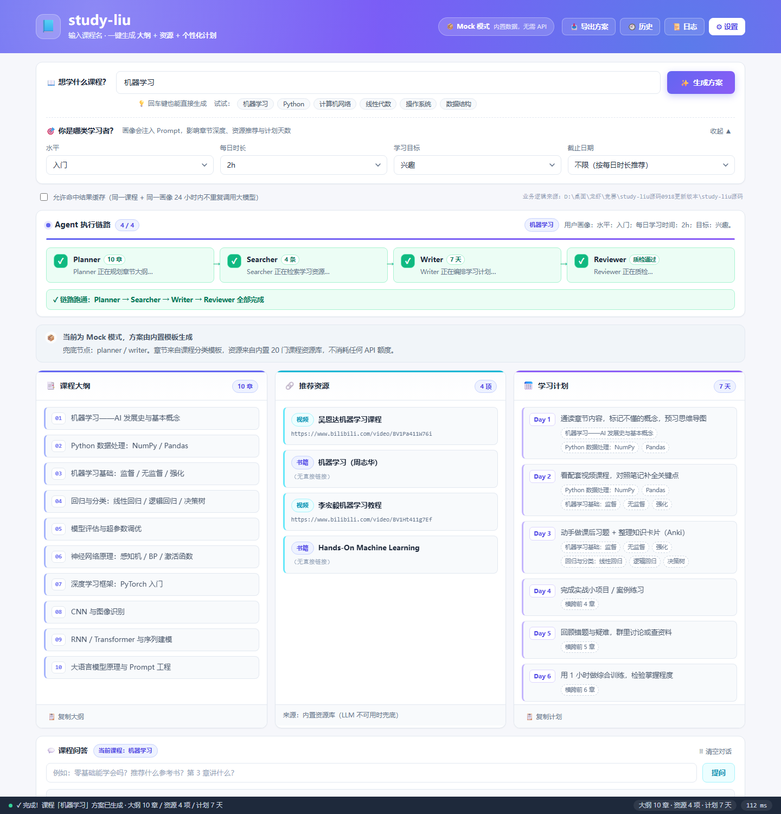

# study-liu Web · 学习智能助手（Vue3 + Vite）

把原 `study-liu` 桌面版（Tkinter）的 **同一套 Agent 代码** 搬到 Web 上，跑通一条完整链路：

> **输入【课程名】** → 意图识别 → **Planner**（课程大纲） → **Searcher**（推荐资源）
> → **Writer**（学习计划） → **Reviewer**（质量检查，不达标自动重跑一轮）
> → **【生成方案】** 三栏结果 + 导出 Markdown


---

## 1. 目录结构

```
study-liu-web/
├── start.bat                 # ★ 一键启动：双击即可（自动找 node + 自动开浏览器）
├── package.json              # 工作区脚本（npm run dev 一键同时起前后端）
├── .gitignore                # 已排除 .env / data/ / node_modules / dist 等
├── docs/
│   └── screenshot.png        # 界面截图
├── scripts/
│   └── dev.mjs               # 无额外依赖的双进程启动器（自动找 Python / 自动开浏览器）
├── server/
│   ├── api_server.py         # ★ 纯标准库 HTTP API，直接 import study-liu 源码
│   └── source.json.example   # 源码路径配置模板（可选，一般用不到）
├── vendor/
│   └── study-liu/            # 原版 study-liu 源码（仅代码，约 1.7MB）
│                             #   已排除 build/ dist/ data/ .env 等产物与隐私
└── web/                      # ★ Vue3 + Vite 前端工程
    ├── index.html
    ├── vite.config.js        # /api 反向代理到 127.0.0.1:8000
    ├── package.json
    ├── public/
    ├── scripts/              # 无浏览器验证工具（见 §10）
    │   ├── ssr-check.mjs     #   能渲染吗 → SSR 渲染 + 内容抽查
    │   ├── click-test.mjs    #   点了有反应吗 → jsdom 真实点击
    │   └── minimal-dom-test.mjs  # 对照实验：jsdom + Vue 最简挂载
    └── src/
        ├── main.js
        ├── App.vue                      # 主界面（链路可视化编排）
        ├── styles/global.css            # 与桌面版 theme.py 同源的配色变量
        ├── api/client.js                # REST + SSE 客户端
        ├── composables/usePlanStream.js # ★ 全链路状态机
        └── components/
            ├── AppHeader.vue            # 顶部 Hero + 模式角标 + 功能入口
            ├── CourseForm.vue           # 【课程名】输入 + 用户画像 + 生成按钮
            ├── PipelineStepper.vue      # ★ Agent 流水线实时状态条
            ├── ResultsGrid.vue          # 三栏结果：大纲 / 资源 / 计划
            ├── ResultPanel.vue          # 结果面板通用外壳
            ├── ChatPanel.vue            # 课程问答（知识库 → 大模型）
            ├── TraceDrawer.vue          # 日志回放（data/trace.log）
            ├── HistoryDialog.vue        # 历史方案（data/progress.json）
            ├── SettingsDialog.vue       # Mock / LLM 模式设置
            ├── ModalDialog.vue
            └── StatusBar.vue            # 固定底部状态栏
```

**关于 `vendor/study-liu/`**：后端会按下面的顺序查找源码目录，
所以 clone 下来**无需任何额外配置**即可直接运行：

1. 环境变量 `STUDY_LIU_SRC`（显式指定，优先级最高）
2. `server/source.json` 里的 `source_path`
3. 工作区里所有 `study-liu*` 目录（本地若放了原版源码，优先用它）
4. **`vendor/study-liu/`（本项目自带的兜底副本）**

---

## 2. 关键技术决策

### 为什么后端不是 Node，而是 Python？

因为 **Agent 逻辑只有一份**。`Planner / Searcher / Writer / Reviewer`、
`run_plan_pipeline`、意图识别、用户画像、缓存、进度存储，全部由原项目的
`core/`、`agents/`、`tools/` 提供。Web 层如果重写一遍，就会出现两套会漂移的实现。

所以后端做的事只有三件：

1. 定位源码目录 → `sys.path.insert`
2. 把函数调用包成 JSON 接口
3. 把 `agent_loop` 写出的 `data/trace.log` **实时转成 SSE 事件流**

### 为什么后端零第三方依赖？

`http.server` + `json` + `threading` 就是全部。原项目里只有 `requests` 是硬依赖
（`core/llm.py`），而系统 Python 通常已经自带；`dotenv`、`cryptography` 在源码里
都是 `try/except` 可选导入。**不需要 pip install 任何东西**。

### 为什么用 SSE 而不是 WebSocket？

「一条链路」的价值在于**看得见推进过程**。SSE 是单向的服务端推送，正好匹配
「Agent 一步一步跑完」的语义，且浏览器原生 `EventSource` 自动处理断流重连，
比 WebSocket 少一半代码。前端还做了降级：SSE 连不上时自动回落到 `POST /api/plan`。

---

## 3. 快速开始

### 前置要求

- **Python 3.9+**（`python --version` 能跑即可）
- **Node.js 18+**

> ℹ️ 本机 Node.js 位于 `D:\【AI】\Node.js\node.js`（v24.15.0），已加入**用户级 PATH**。
> **需要新开一个终端**才会生效（已打开的窗口读的还是旧 PATH）。
> 若换到别的机器、`node -v` 报「找不到命令」，直接双击下面 **方式 A 的 `start.bat`**——
> 脚本会自己去常见目录里把 node 找出来，不依赖 PATH。

### 方式 A：一键启动 · 双击就行（推荐）

在文件管理器里双击项目根目录的 **`start.bat`**，剩下的全自动：

1. 自动定位 `node.exe`（PATH → 常见安装目录 → WorkBuddy 托管目录 → nvm）
2. 自动拉起 Python API（:8000）+ Vite（:5173）
3. 两个服务都就绪后**自动打开浏览器**
4. 关掉窗口 / 按 `Ctrl+C` 即停止前后端

脚本行为说明：

| 场景 | 表现 |
|---|---|
| 端口空闲 | 正常启动前后端，就绪后开浏览器 |
| 服务已在运行 | 不重复占用端口，直接开浏览器 |
| 想强制重启 | 命令行执行 `set FORCE=1 && start.bat` |
| 不想自动开浏览器 | 命令行执行 `set OPEN=0 && start.bat` |

> `start.bat` 内容全 ASCII + 使用 `%~dp0` 自定位，因此**放在含中文的路径下也不会乱码**。
> 若想用命令行启动（前提是 `node` 在 PATH 里）：`npm run dev`，等价于 `node scripts/dev.mjs`。

`scripts/dev.mjs` 会同时拉起：

| 进程 | 地址 | 说明 |
|---|---|---|
| Python API | http://127.0.0.1:8000 | 复用 study-liu 源码 |
| Vite Dev | http://127.0.0.1:5173 | **打开这个** |

首次运行若检测到 `web/node_modules` 缺失，会先自动 `npm install`。

### 方式 B：两个终端手动启动

```bash
# 终端 1 —— 后端
cd study-liu-web
python server/api_server.py --port 8000

# 终端 2 —— 前端
cd study-liu-web/web
npm install
npm run dev
```

浏览器打开 <http://127.0.0.1:5173>。

### 方式 C：指定 study-liu 源码位置

后端按以下顺序自动查找源码根目录（含 `core/agent_loop.py` 的目录）：

1. 环境变量 `STUDY_LIU_SRC`
2. `server/source.json` 里的 `source_path`
3. 工作区中所有 `study-liu*` 目录（及其一级子目录）

手动指定：

```bash
# 环境变量
STUDY_LIU_SRC="D:/path/to/study-liu源码" python server/api_server.py

# 或复制模板改一下
cp server/source.json.example server/source.json
```

---

## 4. 完整链路怎么跑

1. **输入课程名**：在「📖 想学什么课程？」里填 `机器学习`，或点下方的快捷课程按钮。
2. **选用户画像**（可选但推荐）：水平 / 每日时长 / 目标 / 截止日期。
   - 截止日期会**真正影响计划天数**：`tools.user_profile.suggest_plan_length()`
     把剩余天数夹在 `[5, 30]` 之间；无截止日则按总可用时长分档（7 / 14 / 30 天）。
3. **点「✨ 生成方案」**（或直接回车）。
4. 观察 **Agent 执行链路** 条：

   ```
   🧭 Planner → 🔎 Searcher → 📝 Writer → ✅ Reviewer
   ```
   每个节点变绿时会带出真实产出数量（`10 章` / `4 条` / `21 天` / `质检通过`）；
   若 Reviewer 判定不达标，会看到 Writer / Searcher 回环重跑。
5. 三栏结果填充：**课程大纲**（章节）、**推荐资源**（类型 + 链接）、**学习计划**（Day 1…N）。
6. 后续动作：
   - `📥 导出方案` → 下载 Markdown（后端 `render_plan_markdown`）
   - `📜 日志` → 右侧抽屉展示 `data/trace.log` 原始轨迹
   - `💬 课程问答` → 先查知识库，未命中再调大模型
   - `🕘 历史` → 读 `data/progress.json` 回填任意历史方案

---

## 5. API 一览

| 方法 | 路径 | 说明 |
|---|---|---|
| GET | `/api/health` | 健康检查，返回源码目录与 trace 路径 |
| GET | `/api/bootstrap` | 启动元信息：模式 / 画像 / 可选项 / 历史 |
| GET | `/api/mode` | 当前运行模式（mock / llm） |
| POST | `/api/profile` | 保存用户画像 |
| **GET** | **`/api/plan/stream`** | **★ SSE：课程名 → 完整链路（step / trace / result 事件）** |
| POST | `/api/plan` | 非流式生成（SSE 降级用） |
| POST | `/api/chat` | 课程问答（知识库优先） |
| GET | `/api/trace?limit=` | trace.log 尾部 |
| GET | `/api/history` | 历史课程列表 |
| GET | `/api/history/{course}` | 某课程已保存的方案 |
| GET | `/api/knowledge?q=` | 知识库查询 |
| POST | `/api/export` | 导出 Markdown 文本 |
| POST | `/api/settings` | 切换 Mock / LLM 模式 |
| POST | `/api/cache/clear` | 清空结果缓存 |

### SSE 事件协议

```
event: meta      → { course, profile, profile_text, mode, stages, started_at }
event: trace     → { ts, event, data }          # 原始 trace 行
event: step      → { key, status, index, hint, data }   # 驱动流水线状态条
event: result    → { outline, resources, plan, plan_items, stats, markdown, ... }
event: error     → { error }
event: done      → { ok, duration_ms }
```

用 curl 直接看链路：

```bash
curl -N "http://127.0.0.1:8000/api/plan/stream?course=机器学习&level=入门&daily_hours=2h&goal=兴趣&deadline=&use_cache=0"
```

---

## 6. Mock / LLM 双模式

| 模式 | 行为 |
|---|---|
| **Mock**（默认） | 不调用任何在线接口。Planner 走课程分类模板，Searcher 走内置 20 门课资源库，Writer 走 7 天活动模板。**离线可跑，演示零风险。** |
| **LLM** | 调用 DeepSeek / OpenAI / Qwen / GLM / Kimi。API 失败时自动降级到模板，并在界面顶部弹出橙色告警说明「本次方案并非大模型生成」。 |

在「⚙ 设置」里切换。配置优先级：
**界面设置（`data/settings.json`）> `.env` > 系统环境变量**，API Key 落盘自动加密。

原项目的 `core/config.py` 依赖第三方包 `python-dotenv` 才能读 `.env`，
而本后端刻意零第三方依赖 —— 若本机没装 dotenv，`.env` 会被**静默跳过**，
导致你写了 `LLM_PROVIDER=llm` 也永远停在 Mock 模式。

**已内置修复**：后端在 `import core.config` 之前用标准库自行解析 `.env`
（`_load_dotenv_stdlib()`），不依赖 dotenv，行为与桌面版一致。

### 要真正启用 LLM 模式，两步

1. **填 API Key**，两种方式任选：
   - **界面**：点「⚙ 设置」→ 选服务商 → 填 Key → 保存（**立即生效，无需重启**）
   - **文件**：编辑源码目录的 `.env`，把 `LLM_API_KEY=` 补上 Key，然后重启后端
2. **切到 LLM**：点「⚙ 设置」选对应服务商，或在 `.env` 写 `LLM_PROVIDER=llm`

> 顶部角标会直接告诉你当前状态和原因。若显示
> 「已配置 LLM 模式，但缺少 API Key」，说明只差第 1 步。
> 缺 Key 也不会崩 —— 会走模板兜底，并在结果里标注 `degraded`。
>
> 排查用：`curl http://127.0.0.1:8000/api/mode` 返回
> `reason` / `env_loaded` / `has_key` / `env_file_exists`，一眼看出卡在哪一步。

---

## 7. 与桌面版的对应关系

| 桌面版（Tkinter） | Web 版 |
|---|---|
| `ui/main_window.py` 主窗口 | `App.vue` + 各组件 |
| `ui/theme.py` light 主题 | `styles/global.css` CSS 变量 |
| 三栏 `ResultPanel` | `ResultsGrid.vue` |
| 底部状态栏 | `StatusBar.vue` |
| `⚙ 设置模式` 弹窗 | `SettingsDialog.vue` |
| `📜 历史` 弹窗 | `HistoryDialog.vue` |
| trace 日志 | `TraceDrawer.vue` |
| `core/agent_loop.run_plan_pipeline` | 后端 `/api/plan/stream`（**同一函数**） |

---

## 8. 常见问题

**Q：点「生成方案」没反应？**
先确认后端在跑：`curl http://127.0.0.1:8000/api/health`。前端状态栏会直接提示
「后端未启动」。

**Q：为什么每次生成的方案一模一样？**
Mock 模式下章节/资源来自内置模板，这是预期行为。而且同课程 + 同画像在 24 小时内
会**命中结果缓存**（状态栏显示 `⚡ 缓存命中`）。想强制重算，取消勾选「允许命中结果缓存」。

**Q：流水线节点一直卡在「生成中」？**
说明 `data/trace.log` 没有新增内容。检查后端控制台是否有异常堆栈——后端已经把
`data_dir()` 做了不可写回退（会落到 `~/.study-liu/data`），所以不会因为权限问题静默失败。

**Q：能否只部署前端？**
可以。`npm run build` 产出 `web/dist/`，交给任意静态服务器托管；把 `/api` 反代到
Python 后端即可（跨域已在后端放开 `Access-Control-Allow-Origin: *`）。

---

## 9. 构建

```bash
cd study-liu-web
npm run build        # → web/dist/
npm run preview      # 本地预览产物
```

---

## 10. 无浏览器验证（开发用）

前端出问题时，很多症状（「点了没反应」「页面卡住」）在命令行里看不见。
本项目内置了三个**不依赖浏览器**的验证脚本，改完前端可以直接跑：

```bash
cd study-liu-web/web

# ① 能渲染吗 —— SSR 渲染 + 关键内容抽查 + 收集 Vue 警告
node scripts/ssr-check.mjs

# ② 点了有反应吗 —— jsdom 加载真实构建产物 + 真实 dispatch 点击事件
node <vite> build --outDir dist-ct1     # 先构建（任一卷包器路径均可）
npm i -D jsdom                          # 首次需要
node scripts/click-test.mjs dist-ct1

# ③ 对照实验 —— 只挂载一个最简组件，用来判断问题出在环境还是应用代码
node scripts/minimal-dom-test.mjs
```

**① 与 ② 的区别很关键**：SSR 只能证明「组件能渲染」，
证明不了「事件能响应」——而「点按钮没反应」恰恰属于后者，
必须用 ② 才能真正复现。

> 定位「无限重渲染」的小技巧：给 `Element.prototype.setAttribute/getAttribute`
> 装计数器并打印元素标签与属性名。若某个属性被调用十几万次且集中在同一批元素上，
> 就说明不是「在创建元素」而是「同一批元素被反复 patch」= 无限重渲染。

---

## 界面预览


